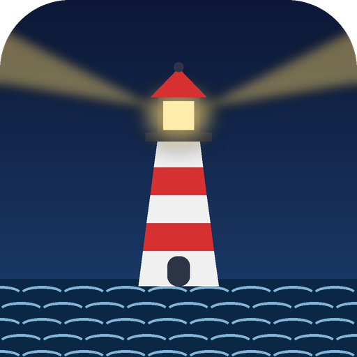

<div align="center">



# Jenkins Lighthouse 🗼

**A lighthouse for legacy Jenkins and nginx in the AI era.**
Upgrade old Jenkins **safely to 2.580.x LTS** (builds keep working, rollbackable, per-job acceptance); patch nginx high-severity CVEs **fleet-wide** (containers, rpm, source builds, OpenResty, private-registry frontends — every step gated).

[](https://github.com/seaworld008/jenkins-lighthouse/actions/workflows/ci.yml)
[](https://github.com/seaworld008/jenkins-lighthouse/releases)
[](LICENSE)
[](https://docs.claude.com/en/docs/claude-code)

[中文](README.md) · [Case studies](case-studies/) · [For AI agents](AGENTS.md)

</div>

---

## What is it

Two agent skills distilled from real production upgrades in November 2026 (one dev Jenkins 2.346.1, one prod Jenkins 2.275, both → 2.580.2 LTS; a multi-host nginx CVE fleet upgrade across Alibaba Cloud and Huawei Cloud):

- **jenkins-lts-upgrade** — survey legacy Jenkins (war/Tomcat/rpm/docker on Java 8/11), rehearse on a data copy, cut over to a Docker Compose controller (Java 21/25) with host agents, keep business builds on a supported JDK 8, verify every job with real builds, roll back if needed.
- **nginx-vuln-upgrade** — baseline-gated fleet upgrades for nginx CVEs: probe matrix from `nginx -T`, trial container comparison, image/rpm/source/OpenResty/Harbor-frontend swaps with auto-rollback, TLS 1.2/1.3 enforcement with correct handshake verification, and the full frontend image chain (rebase → registry → kubectl rollout → Jenkins FROM rewrite).

Every pitfall listed in [README.md](README.md) (Chinese) was hit for real; each has a countermeasure in the skills.

## Quick start

```
/plugin install jenkins-lighthouse --marketplace seaworld008/jenkins-lighthouse
```

Or clone the repo and copy `skills/*` into `~/.claude/skills/`, or use the scripts directly without any AI.

## Structure

```
skills/jenkins-lts-upgrade/   Jenkins LTS upgrade skill
skills/nginx-vuln-upgrade/    nginx CVE fleet upgrade skill
case-studies/                 4 sanitized real-world reports
tools/check_repo.py           repo self-check (structure, versions, sensitive data)
tests/                        unit tests
```

## License

[MIT](LICENSE)
